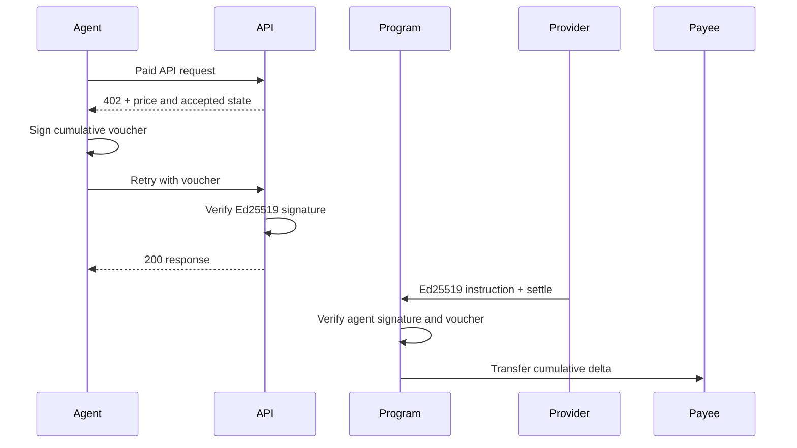

# MeterBox

Payment infrastructure for autonomous AI agents on Solana.

AI agents cannot rely on cards for machine-to-machine API payments. Direct on-chain payments are slow and expensive for every call. MeterBox combines HTTP 402 paywalls with signed cumulative Ed25519 vouchers and one final Anchor settlement.

## How it works



## Quickstart

```bash
npm install
npm test
cp .env.example .env
npm run dev
```

Open `http://localhost:5173`.

Production:

```bash
npm run build
npm start
```

## Modes

- `SOLANA_MODE=demo`: no wallet or keypair is required. The UI clearly shows DEMO MODE.
- `SOLANA_MODE=devnet`: configure the RPC, program ID, and provider keypair. The current environment must have a deployed program and provider keypair.

## SDK

Agent:

```js
import { createMeterBoxFetch } from "meterbox-sdk";
const mbFetch = createMeterBoxFetch({
  agentKeypair,
  channel,
  baseUrl: "http://localhost:8787",
  spendingLimitLamports: 1_750_000,
});
await mbFetch("/api/paid/weather");
```

Provider:

```js
import { meterbox } from "meterbox-sdk";
app.get("/weather", meterbox.charge(100_000), handler);
```

## Solana

- Program ID: `Ga2tqUHwpZBCK26AJjcYsUoA4JtLzuRmMZkn72WdR1jz`
- Explorer: https://explorer.solana.com/address/Ga2tqUHwpZBCK26AJjcYsUoA4JtLzuRmMZkn72WdR1jz?cluster=devnet
- Devnet status: **deployed and verified**.
- Deploy transaction: https://explorer.solana.com/tx/2P5Xv7bu93MNhGmQPRryCpYocpECQy1KCy9Tkm283n2nCQjgJEnY3f1ukFS3pQPenbHgVhNv3GJTiCjogo855Wp7?cluster=devnet
- Demo open transaction: https://explorer.solana.com/tx/2N8zWcT9Bo2Vx2JRfiyidpSQfqC6f9fGHpHMuGpqdxP5B8bPPSvcmcsLA52k7ZUfzRC53jNTdfi34wqmNXxuGFk?cluster=devnet
- Channel PDA: https://explorer.solana.com/address/Gv1ccx86XwuFPxWWwBbeX8LVp8tw5uL3LXgd7nWjPmEM?cluster=devnet
- Settled transaction with Ed25519 + settle: https://explorer.solana.com/tx/5yqYegpHKzpNmk46vTxiUEEt8frahSerMFaXg5cTKmJawcmKoJd882b5m6njZgEj1v7jpctjf3dP4FsCxnu1by3j?cluster=devnet
- Close/refund transaction: https://explorer.solana.com/tx/613YHo1Tr6QCAKH4qpvJxP8DmHHH1MYnbuRaHsyDwom8JVKG4vWiGk7TD2XUGmk15TTLMBBuBtdxg5QwqusDdRgq?cluster=devnet
- Program source: `programs/meterbox/src/lib.rs`

The program keypair is generated locally under `data/meterbox-program.json`; that directory is git-ignored. It has not been deployed unless the deploy command has completed successfully.

Deploy:

```bash
npm run program:deploy
```

## Security model

The server verifies vouchers off-chain before returning API data. The Anchor settle instruction also verifies the previous Ed25519 instruction, the channel agent, the exact cumulative voucher message, nonce, limits, and rent-exempt minimum. Cooperative close is available to the payee; payer close is available after expiry.

## Honest limitations

- SOL channels only.
- The browser demo agent key is held in memory.
- Demo settlement is intentionally not an on-chain transaction.
- Devnet deploy and real wallet/close flows require the Solana/Anchor toolchain and funded wallet.
- The provider currently supports one payee per channel.

## Demo

```bash
npm run demo
npm run demo:agent
```

## License

MIT
