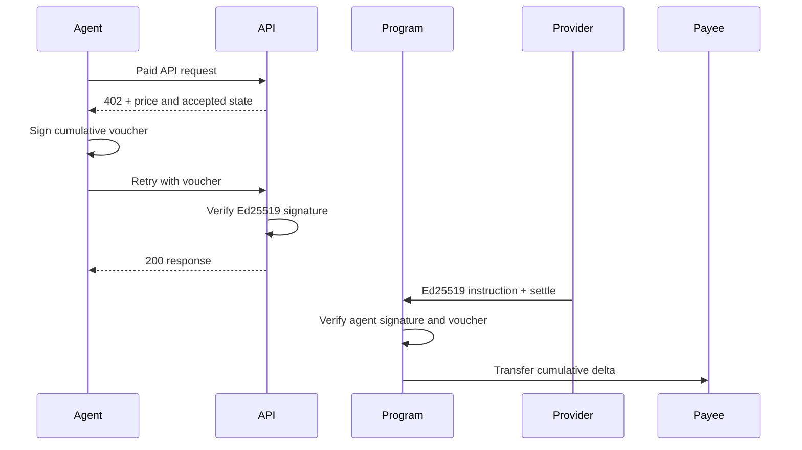

# MeterBox

Payment infrastructure for autonomous AI agents on Solana.

AI agents cannot rely on cards for machine-to-machine API payments. Direct on-chain payments are slow and expensive for every call. MeterBox combines HTTP 402 paywalls with signed cumulative Ed25519 vouchers and one final Anchor settlement.

## How it works



## Quickstart

```bash
corepack pnpm@9.15.9 install
corepack pnpm@9.15.9 test
cp .env.example .env
corepack pnpm@9.15.9 dev
```

Open `http://localhost:5173`.

Production:

```bash
corepack pnpm@9.15.9 build
npm start
```

## Modes

- `SOLANA_MODE=demo`: no wallet or keypair is required. The UI clearly shows DEMO MODE.
- `SOLANA_MODE=devnet`: configure the RPC, program ID, and provider keypair. The current environment must have a deployed program and provider keypair.

## SDK

Agent:

```js
import { createMeterBoxFetch } from "meterbox-sdk";
const mbFetch = createMeterBoxFetch({
  agentKeypair,
  channel,
  baseUrl: "http://localhost:8787",
  spendingLimitLamports: 1_750_000,
});
await mbFetch("/api/paid/weather");
```

Provider:

```js
import { meterbox } from "meterbox-sdk";
app.get("/weather", meterbox.charge(100_000), handler);
```

## Solana

- Program ID: `Ga2tqUHwpZBCK26AJjcYsUoA4JtLzuRmMZkn72WdR1jz`
- Explorer: https://explorer.solana.com/address/Ga2tqUHwpZBCK26AJjcYsUoA4JtLzuRmMZkn72WdR1jz?cluster=devnet
- Devnet status: **deployed and verified**.
- Deploy transaction: https://explorer.solana.com/tx/2P5Xv7bu93MNhGmQPRryCpYocpECQy1KCy9Tkm283n2nCQjgJEnY3f1ukFS3pQPenbHgVhNv3GJTiCjogo855Wp7?cluster=devnet
- Verified five-call run (weather, sentiment, price, search, image; 1,750,000 lamports):
  - Open: https://explorer.solana.com/tx/3Rrot9MFcvMrifYRUDWpUKR2V4Mdk1nmJbMf3U974MPqYZpTGkRAkBGyG5uwKv4n1psYBd2pj9WNkdgNMn9CDLMB?cluster=devnet
  - Channel (closed after settlement): https://explorer.solana.com/address/A2agETbFZQxePbvXpFJMX3tm8ZFjACNX9W4MhjUUVj9i?cluster=devnet
  - Settle (Ed25519 verification + MeterBox): https://explorer.solana.com/tx/3RbyDkM1MbBpLWM9acYdFsjNhy5Q9eJotQAu5SssunztmLZTMcYCWGo1zCuyEjMXhgRjJXBfVueftPGJZ7GYyBmT?cluster=devnet
  - Close/refund: https://explorer.solana.com/tx/3YxkM6edXEf3SvzAodNFE2uvPNc3dZA6ssziWNTr1eyY63mqeLtozf8zUsKbgztxjvuXFbQgwsjB6NzEbBUvAbrL?cluster=devnet
- Program source: `programs/meterbox/src/lib.rs`

The deployment keypair stays local and is git-ignored. The program is deployed to devnet at the program ID above.

Deploy:

```bash
corepack pnpm@9.15.9 program:deploy
```

## Security model

The server verifies vouchers off-chain before returning API data. The Anchor settle instruction also verifies the previous Ed25519 instruction, the channel agent, the exact cumulative voucher message, nonce, limits, and rent-exempt minimum. Cooperative close is available to the payee; payer close is available after expiry.

## Honest limitations

- SOL channels only.
- The browser demo agent key is held in memory.
- Demo settlement is intentionally not an on-chain transaction.
- Devnet deploy and real wallet/close flows require the Solana/Anchor toolchain and funded wallet.
- The provider currently supports one payee per channel.

## Devnet demo

```bash
SOLANA_MODE=devnet PROVIDER_KEYPAIR_PATH="$HOME/.config/solana/id.json" corepack pnpm@9.15.9 dev
SOLANA_MODE=devnet PROVIDER_KEYPAIR_PATH="$HOME/.config/solana/id.json" corepack pnpm@9.15.9 demo:agent
```

The CLI flow opens a devnet channel, makes five signed paid API requests, settles the cumulative voucher, and closes the channel. The browser playground is read-only in devnet mode; its channel operations are available in demo mode.

## License

MIT
